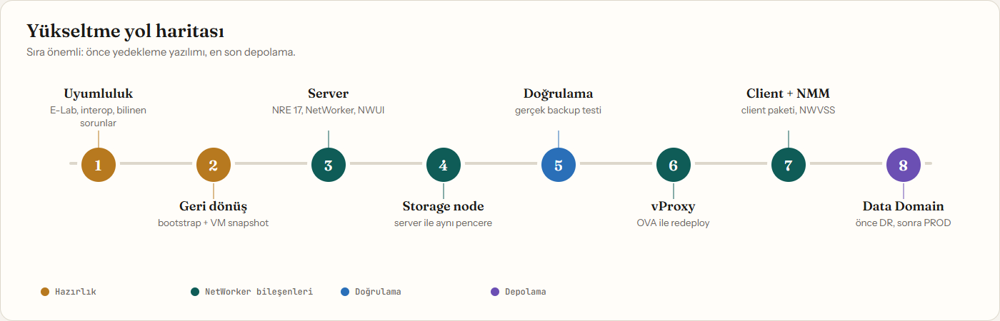
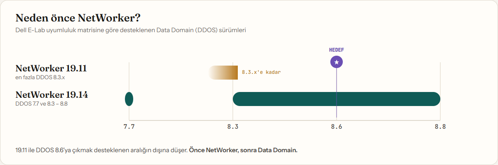
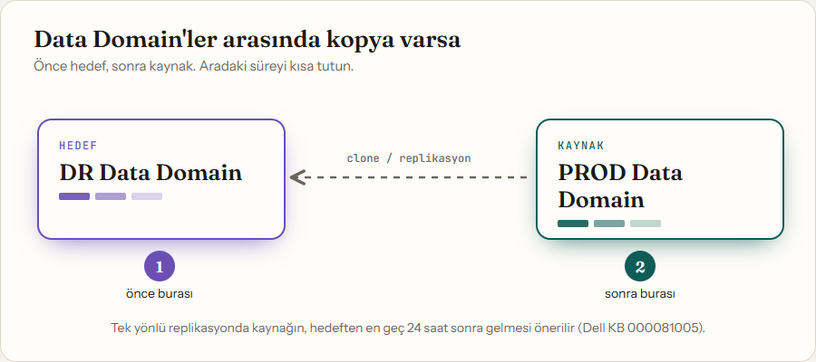

Yedekleme sistemini yükseltmek, uçakta motor değiştirmeye benzer: uçuş sürerken yapıyorsunuz ve bir şey ters giderse geri dönecek bir yer olmalı. Üstelik bu işte en sık yapılan hata aracın kendisi değil, **sıra**. Önce depolamayı yükseltirsiniz, sonra yedekleme yazılımının o sürümü desteklemediğini görürsünüz.

Bu rehberde Dell NetWorker'ı **19.11'den 19.14.0.1'e**, ardından Data Domain'i **DDOS 8.6'ya** yedekleri kesmeden nasıl taşıdığımızı anlatıyorum. Adımları gerçek bir kurumsal ortamda uyguladık: önce NetWorker server ve storage node, sonra vProxy'ler, client'lar ve SQL (NMM) bileşenleri, en son DR tarafındaki Data Domain 8.6'ya geçti.

<div class="callout callout--warning">
<strong>⚠ Ortamınızı kendiniz kontrol edin</strong> Bizim ortamda NetWorker'dan yalnızca PROD ve DR tarafındaki Data Domain'lere backup alınıyordu; bu yüzden yükseltmeden önce yapı bu açıdan kontrol edildi. Siz bu işlemleri yaparken <b>backup aldığınız tüm ürünleri ve hedefleri</b> ayrı ayrı kontrol etmeniz gerekir. Bir bileşenin hedef sürümle uyumlu olması, diğerinin de uyumlu olduğu anlamına gelmez.
</div>



## Ne zaman gerekir?

Data Domain'i DDOS 8.6'ya taşımak istiyorsanız **önce NetWorker'a bakın.** Dell E-Lab uyumluluk matrisine göre:

- NetWorker **19.11**, en fazla **DDOS 8.3.x** sürümünü destekliyor.
- NetWorker **19.14**, **DDOS 7.7 ve 8.3–8.8** aralığını destekliyor.



Yani doğru sıra şu: **önce yedekleme yazılımı, sonra depolama.**

Ortamımız şöyleydi:

| Bileşen | Rol |
|---|---|
| NetWorker Server | Server, NMC, AuthC, NWUI (Windows, VM) |
| Storage Node | Fiziksel sunucu |
| vProxy | VMware image-level backup (PROD ve DR) |
| Data Domain | PROD ve DR'da birer adet; PROD'dan DR'a clone |
| Client'lar | File, SQL (NMM) ve sistem backup'ları |

## Adım 1: Uyumluluğu doğrulayın

Kurulum dosyasına dokunmadan önce üç şeye bakın:

1. **E-Lab uyumluluk matrisi.** Hedef NetWorker sürümünün DDOS, vProxy ve mevcut client sürümlerinizi desteklediğini kontrol edin.
2. **Interop raporu.** 19.14 server, 19.8–19.14 arasındaki client'larla çalışıyor. Storage node ise en az 19.12 olmalı. Bu yüzden ikisini **aynı pencerede** yükseltin. 19.8'den eski client'lar (örneğin 19.5) bu aralığın dışında kalır ve destek dışı olur; bunları server ile birlikte ya da ondan önce yükseltin.
3. **Bilinen sorunlar.**
   - 19.13 ve sonrası **NRE 17 (Java 17)** istiyor. NRE 8 ile kurulum yarıda geri dönüyor (Dell KB 000334255).
   - Windows'ta NMC'nin PostgreSQL 16 geçişinde bir hata var ve **19.14.0.1**'de düzeltildi (KB 000450024). 19.14.0.0 yerine 19.14.0.1'i seçin.
   - NMC Launcher kaldırıldı. NMC artık **OpenWebStart** ile açılıyor (KB 000334281).

<div class="callout callout--warning">
<strong>⚠ Dikkat</strong> Sürümü E-Lab'den seçin, ezberden değil. Hedef sürüm; DDOS, vProxy ve client uyumluluğunun kesiştiği yerde olmalı.
</div>

## Adım 2: Geri dönüş yolunu hazırlayın

Yükseltmenin en sıkıcı ama en değerli kısmı bu. Servisi durdurmadan önce:

1. Mevcut NetWorker, NRE/Java sürümlerini ve servis durumlarını kaydedin.
2. Policy, workflow, device ve pool listesini çıkarın.
3. Bootstrap kayıtlarını dosyaya alın. Geri dönüşte hangi bootstrap'tan kurtaracağınızı bilirsiniz:

```text
mminfo -B > C:\NW_Upgrade\mminfo_B_before.txt
```

4. AuthC kullanıcılarını ve administrator erişimini doğrulayın.
5. **Server Protection** (bootstrap) backup'ının başarılı olduğunu kontrol edin.
6. Çalışan job olmadığından emin olup NetWorker server VM'inin **snapshot**'ını alın.
7. Ancak bundan sonra servisleri durdurun.

En kötü senaryoda snapshot'a dönüp aynı gün eski sürüme geri gelebilirsiniz. Bu güvenlik ağı, yükseltmeye girerken içinizi rahatlatır.

<div class="callout callout--danger">
<strong>⚠ Kritik</strong> Snapshot almadan servis durdurmayın. Geri dönüş yolu, yükseltmenin kendisi kadar önemlidir.
</div>

## Adım 3: NetWorker Server'ı yükseltin

1. **Önce NRE 17'yi kurun.** Bu adım atlanırsa NetWorker kurulumu rollback olur.
2. **Ana NetWorker paketini çalıştırın.** Paketin içinde birden fazla exe var. Server için `networkr` klasöründeki `NetWorker-19.14.0.1.exe`'yi kullanın. Server, NMC ve AuthC birlikte güncellenir.
3. **NWUI'yi kurun.** Yeni web arayüzü ayrı bir paket (`NWUI-19.14.0.1-x64.exe`).
4. **Extended Client'ı güncelleyin.**
5. **Servisleri ve sürümleri kontrol edin.** Tüm bileşenler 19.14.0.1 görünmeli, servisler ayakta olmalı.
6. **NMC erişimini yeniden kurun.** Yönetici bilgisayarına NRE 17 ve OpenWebStart kurun. NMC artık tarayıcıdan `.jnlp` ile açılıyor.

<div class="callout callout--info">
<strong>Not</strong> NRE 17 önce gelir. 19.13 ve sonrası Java 17 olmadan kurulmaz. Ayrıca doğru installer'ı kullanın: server için <code>networkr</code> klasöründeki ana paket, client için <code>lgtoclnt</code>, NWUI için ayrı paket.
</div>

## Adım 4: Storage Node'u yükseltin

1. Storage node'da ana NetWorker paketiyle **Storage Node, Client ve Extended Client**'ı 19.14.0.1'e çıkarın. Client bileşeni reboot isteyebilir, bunu bakım penceresine koyun.
2. Sürümleri kontrol edin. DD device'ları yükseltme öncesiyle aynı durumda olmalı.

Server ve storage node'u **aynı gün** yükseltin: 19.14 server, 19.12'den eski bir storage node ile desteklenmiyor. Storage node'u unutmak, "her şey yükseldi ama backup çalışmıyor" sürprizinin klasik sebebi.

## Adım 5: Gerçek backup ile doğrulayın

"Kurulum başarılı" ekranı yeterli değil. Başarı ölçütü ekran değil, Data Domain'e yazılan veridir. Şunları test edin:

| Test | Beklenen |
|---|---|
| Server Protection (bootstrap) | Başarılı |
| Zamanlanmış SQL transaction log backup'ı | Yükseltme sonrası ilk çalışmada Data Domain'e yazılmalı |
| Tek VM için VMware backup | Başarılı |
| Device ve pool durumu | Yükseltme öncesiyle aynı |
| NMC ve NWUI erişimi | İkisi de açılmalı |

NMC'de tek bir VM'i yedeklemek için workflow satırına sağ tıklayıp **Start Individual Client**'ı kullanın. Tüm sistemi başlatmadan hızlı bir test böyle yapılır.

## Adım 6: vProxy'leri redeploy edin

vProxy bir appliance. İçine paket kurarak değil, yeni sürümün OVA'sından **redeploy** ederek yükseltilir (Dell KB 000197385). NetWorker 19.14.0.1 ile eşleşen sürüm **4.4.0-21** (KB 000250114). İlk denemeyi DR'daki proxy ile yapın. vProxy 4.4, vCenter/ESXi 7.0–9.1 aralığını destekliyor; kendi vCenter ve ESXi sürümlerinizi yükseltmeden önce kontrol edin.

1. vProxy OVA'sını Dell Support'tan indirin ve NetWorker server'da şu klasöre koyun (`ovas` klasörünü elle oluşturun):

```text
C:\Program Files\EMC NetWorker\nsr\vproxy\vproxy_ova\ovas\
```

2. Proxy'nin root şifresini hazırlayın; 8–20 karakter olmalı. Şifre bilinmiyorsa 4.4.0.x proxy'lerde GRUB üzerinden sıfırlanabilir (KB 000010703).
3. Proxy'nin ağ ayarlarını (IP, mask, gateway, DNS) not alın. Proxy elle kurulmuşsa NetWorker kaydındaki deploy alanları boş olur. NetWorker eksik bilgileri vCenter'daki mevcut VM'den kendisi okur.
4. NWUI'de **Protection > VMware Proxies > Redeploy** ile proxy'yi seçin, **Enter Root Password** ile şifreyi girin ve başlatın. Redeploy, yeni VM'i aynı IP ve hostname ile açıp eskisinin yerine koyar.
5. İlerlemeyi server'daki log'lardan izleyin:

```text
C:\Program Files\EMC NetWorker\nsr\logs\adhoc\nsrvproxy_mgmt
```

6. `nsradmin` ile proxy kaydında yeni sürümü görün, ardından tek VM'lik bir test backup alın.

<div class="callout callout--info">
<strong>Not</strong> vProxy root şifrelerini kayıt altına alın. Redeploy root şifresi ister; şifre elinizdeyse iş dakikalar sürer.
</div>

## Adım 7: Client'ları ve SQL (NMM) bileşenlerini yükseltin

<div class="callout callout--danger">
<strong>⚠ Bu adım, Adım 8'den önce gelmek zorunda</strong> Client Direct ile Data Domain'e doğrudan yazan client'lar, DD 8.6'ya çıkmadan önce 19.14'te olmalı. 19.11 client'lar, DDOS 8.3'ten yenisini desteklemiyor. Yani client'ları atlayıp Data Domain'e geçerseniz, doğrudan yazan client'ların backup'ı kopabilir.
</div>

1. Client'larda `lgtoclnt-19.14.0.1.exe` paketini çalıştırın.
2. SQL sunucularında NMM'i, NMM 19.14.0.1 paketindeki `NWVSS.exe` ile yükseltin.
3. Client ve NMM yükseltmesi reboot isteyebilir. SQL sunucularını bakım penceresinde yapın.
4. Her sunucuda sürümü kontrol edin ve bir sonraki zamanlanmış backup'ın başarılı olduğunu görün.

## Adım 8: Data Domain'i DDOS 8.6'ya yükseltin

NetWorker tarafı hazır olduğunda Data Domain'e geçin. DDOS 8.6 Release Notes'a göre 7.7.x ve 8.3 dahil birçok sürümden 8.6'ya **tek adımda** geçilebiliyor, ara sürüm gerekmiyor.

<div class="callout callout--danger">
<strong>⚠ Data Domain'de geri dönüş yok</strong> Dell, PowerProtect DD platformlarında DDOS'u eski sürüme düşürmeyi desteklemiyor (KB 000081247); desteklenen tek yön, daha yeni bir sürüme geçmek. NetWorker'da snapshot ile aynı gün geri dönebiliyordunuz; Data Domain'de böyle bir yol yok. Bu yüzden bu adıma, NetWorker tarafının gerçek backup'larla sorunsuz çalıştığını gördükten sonra girin.
</div>

1. **Önce şunu sorun: iki Data Domain arasında veri akışı var mı?** Her birinin backup yazılımıyla uyumuna bakmak yetmez; aralarında veri akıyorsa birbirleriyle uyumuna da bakmak gerekir.

| Durum | Ne yapmalı |
|---|---|
| Aralarında veri akışı var: NetWorker clone (DD Boost dosya replikasyonu, MFR/CCR), DD'nin kendi replikasyonu (MTree, collection ya da directory; `replication show config` ile görürsünüz) ya da başka bir uygulamanın replikasyonu (örneğin PPDM, Avamar) | Uyum ve sırayı planlayın |
| İki DD tamamen bağımsız, aralarında kopya yok | Her birini kendi backup yazılımıyla uyumuna bakarak ayrı ayrı yükseltebilirsiniz |


   Aranızda veri akışı varsa şunlara dikkat edin:

   - **Sürüm farkı:** Dell'in DDOS FAQ'ına göre (KB 000081005), replikasyon yapan sistemler en fazla iki DDOS sürüm ailesi farkında kalmalı. Kesin desteklenen kombinasyonlar için Dell'in uyumluluk tablosuna bakın.
   - **Sıra:** Tek yönlü replikasyonda önce hedef (DR), 24 saat içinde kaynak (PROD). Collection replication'da önce hedef, sonra kaynak. İki yönlü replikasyonda sıra fark etmez.
   - **Aradaki süre:** İki DD'nin farklı sürümlerde kaldığı süreyi kısa tutun. DDOS'ta eski sürüme dönüş desteklenmediği için sırayı baştan doğru planlayın.
   - **Pratik kontrol:** Hedef DD'yi yükselttikten sonra ilk clone/replikasyon job'larının başarılı olduğunu doğrulayın. Kaynağı ancak ondan sonra yükseltin.



2. **Ön kontrolleri yapın** (DD SSH):

```text
system show version
filesys show space
replication show config
alerts show current
```

   - En az **%10 boş alan** olmalı.
   - Açık alarm olmamalı.
   - 8.6'da directory replication desteklenmiyor; varsa önce çözün.

3. **Zamanlamayı seçin.** Yükseltme sırasında DD yeniden başlar. Clone ve backup job'larının çalışmadığı bir pencere seçin.
4. **RPM'i yükleyin, DD'ye kendini kontrol ettirin, sonra başlatın.** RPM'i yükledikten sonra `system upgrade precheck` ile Data Domain'in kendi ön kontrolünü çalıştırın, ardından yükseltmeyi başlatın. Süre platforma ve veri miktarına göre değişir. İşlem sürerken sistemi kapatmayın.
5. **Sonrasında doğrulayın.** `system show version` ile yeni sürümü görün. NetWorker'da device'ların mount olduğunu ve ilk backup ile clone'un başarılı olduğunu kontrol edin. SupportAssist/autosupport yapılandırmasının hâlâ yerinde olduğunu da doğrulayın.

Bu adımlarla DR Data Domain'i 8.3'ten 8.6.1.30'a sorunsuz taşıdık.

## Aklınızda kalsın

- **Sürümü E-Lab'den seçin.** DDOS, vProxy ve client uyumluluğunun kesiştiği yerde kalın.
- **Ara patch sürümünü atlamayın.** 19.14.0.0 yerine 19.14.0.1, bilinen bir NMC veritabanı hatasından kurtarır.
- **NRE 17 önce gelir.**
- **Doğru installer'ı kullanın:** server için `networkr`, client için `lgtoclnt`, NWUI için ayrı paket.
- **Data Domain'de geri dönüş yok.** DDOS eski sürüme düşürülemez (KB 000081247); NetWorker'ı doğruladıktan sonra girin.
- **Client'ları Data Domain'den önce yükseltin.** Client Direct ile DD'ye yazan client'lar, DD 8.6'dan önce 19.14'te olmalı. Eski (19.8 öncesi) client'ları da unutmayın.
- **Snapshot almadan servis durdurmayın.**
- **Storage node'u unutmayın.** Server ile aynı pencerede yükseltin.
- **vProxy şifrelerini kayıt altına alın.**
- **Data Domain'lerde sıra önemli.** Kopya varsa önce hedef, sonra kaynak; hedefte ilk clone başarılı olmadan kaynağa geçmeyin. Aradaki süreyi uzun tutmayın.
- **Gerçek backup ile test edin.**

## Kaynaklar

- Dell KB 000334255 (NRE 17 gereksinimi), 000450024 (NMC PostgreSQL düzeltmesi), 000334281 (NMC ve OpenWebStart)
- Dell KB 000197385 (vProxy redeploy), 000250114 (vProxy sürüm eşleşmesi), 000010703 (vProxy root şifresi)
- Dell KB 000081005 (DDOS upgrade FAQ), DDOS 8.6 Release Notes
- Dell E-Lab NetWorker 19.11 ve 19.14 uyumluluk raporları

*Bu yazıdaki ortam bilgileri ve yollar genel örneklerdir; kurumunuzun adı, sunucu adları ve ağ bilgileri yazıya alınmamıştır.*
